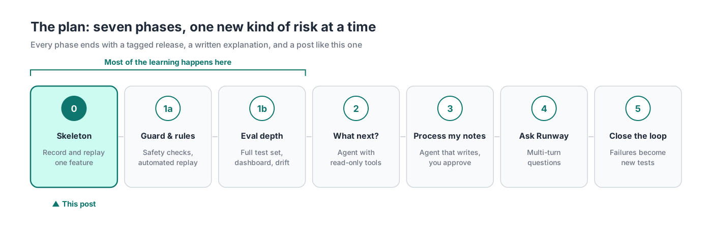
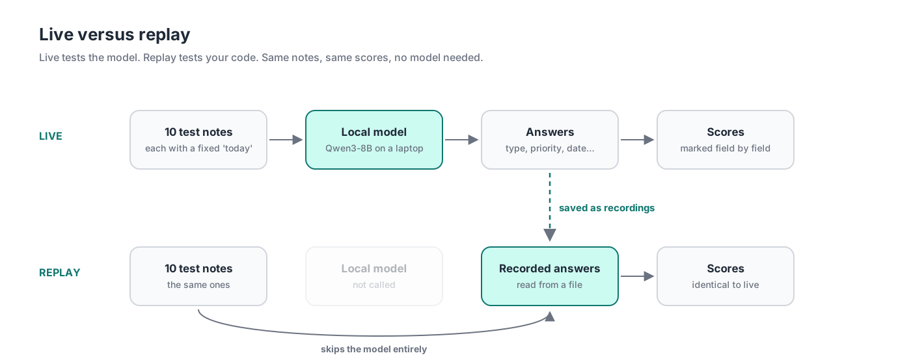

When I started testing the AI features in one of my apps, my first question was simple: **can I get the same answer twice?** With normal software, you mostly take that for granted.

## AI testing vs traditional software testing

Most traditional software is built to be deterministic: given the same inputs and the same environment, it gives the same output. When it doesn't, the cause is usually something the test hasn't pinned down yet, like the clock, the network or the order tests run in, and good testers put a lot of craft into pinning those things down. But AI models vary by design. They're built to choose their words with a little randomness thrown in for good measure, and for many questions there's more than one good answer. So the task shifts from removing variation to measuring it, and from checking for *the* right answer to checking for *a* right one.

Aviation offers a useful way to think about this. Yep, I'm an aviation nut!No two flights on the same route are identical: the wind, the weight and the pilot's small corrections all differ, yet a good flight still lands safely at the right airport. An AI model is similar in many respects. Ask it the same thing twice and the answers will land in much the same place, but rarely word for word. There are a few reasons for that:

- **Sampling.** A model builds an answer one word at a time, picking from a shortlist of likely options. That element of chance is deliberate, and it's why the answers read naturally.
- **Turning the randomness down narrows the spread.** Settings like *temperature* make the model favour its top choice, and tiny numerical differences in the hardware can still tip a close call the other way.
- **The model itself can change.** Hosted models are updated by their providers, sometimes even behind the same name. Whereas, a model running on your local machine stays exactly as it is until you change it.

That variation makes familiar testing problems harder:

- **Knowing what caused a change.** When a score moves, was it my code, my instructions to the model, or the model just answering differently this time? Normally only the first two are possible.
- **Reproducing problems.** In normal software, if a user hits a bug, you rerun the same input and get the same bug. With AI, you rerun the same input and might get a perfectly good answer, so the bug seems to vanish. The only way to investigate is to have logged exactly what happened the first time: the prompt, the model version, the settings, and the output.
- **Trusting the tests.** A test that checks AI output might pass on one run and fail on the next with no code change, purely because the model phrased things differently. That's a flaky test, and teams learn to ignore flaky tests, which means they also ignore the real failures.
- **Comparing models fairly.** If you run your test suite once against model A and once against model B, and A scores higher, that might just be A catching a tailwind. One flight each doesn't tell you which aircraft performs better. You need several runs to see a real difference.
- **Earning users' trust.** People notice when the same request gets a different answer on Tuesday.

With traditional software, repeatability comes built in. With AI features, the model won't give you that, so you have to build it into how you test. Aviation solved a version of this problem decades ago with the **flight recorder**, the "black box" that captures what the aircraft did and the conditions it did it in, so investigators can replay a flight on the ground long after it has landed. This post is about how I'm building the same thing for my app: every call to the model is a flight where every call gets recorded, and my scoring code is the investigator reading the data. I'm really stretching this analogy aren't I? But it works.

## The idea, and where it came from

I picked this up from [an article by Eferhire on HackerNoon](https://hackernoon.com/the-missing-layer-in-ai-agents-evaluation-tracing-and-failure-detection-before-production-breaks), which describes a dedicated layer for testing and monitoring AI features. It runs as a loop: **trace** every call to the model, **replay** past calls on demand, **score** the results, **regression-test** after every change, and **analyse failures** step by step.

You only really understand an architecture once you've run it, so I'm building this into [Runway](https://github.com/nicetrygee/runway), a planner I built for my own work as an Engineering Manager.

## The plan

Runway has an AI feature called **Quick Add**. You type a scrappy note like *"chase Lukas about the hiring panel by Friday"* and it fills in a task: the type, priority, effort, who's involved and when it's due. That's going to be the first feature to get a flight recorder. Later phases add three more AI features, each bringing a new kind of risk: one that reads data, one that changes data, and one that holds a conversation.

I've also set some ground rules which will shape the whole thing:

- **It's free to run.** Models run locally on my 16GB MacBook Air using [LM Studio](https://lmstudio.ai), with a paid model joining occasionally for comparison.
- **Everything is traced, and the data is made up.** Every call is logged, and every task, person and note is synthetic.
- **Agents build it, and I check it.** [Claude Code](https://www.anthropic.com/claude-code) writes the code. I write the specs, review every change and decide what "correct" means.
- **Small steps.** One change per pull request, and a tagged release and I'll try and also write a blog post at the end of each phase.

My full plan is in the repo: [docs/eval-observability.md](https://github.com/nicetrygee/runway/blob/main/docs/eval-observability.md).

## Phase 0: the walking skeleton

A **walking skeleton** is Alistair Cockburn's term for the thinnest version of a system that works end to end. I'll admit my first draft of the plan opened with seven pieces of careful groundwork, which is the planning equivalent of building a hangar before anything has flown. So I threw that away and decided to get one working loop up and running and let this teach me what the groundwork needed to be.

Phase 0 came in three pull requests ([spec here](https://github.com/nicetrygee/runway/blob/main/docs/slices/slice-e0-skeleton.md)):

1. **The flight recorder.** Every AI call in Runway now goes through one small piece of code that also writes a trace of each call. Quick Add moved from a paid model to Qwen3-8B running locally.
2. **The test flights.** Ten made-up notes, each with the answer I'd expect. ([The cases](https://github.com/nicetrygee/runway/blob/main/evals/quick_add/cases.jsonl).)
3. **The investigation.** A runner with two modes, *live* and *replay*.

**Live** is flying the route: the model answers each note, and the answers are scored and saved as recordings. **Replay** is the investigators on the ground, running the recorded data back through their analysis in seconds while the aircraft stays in the hangar.

Netflix used the same principle at much bigger scale. In 2023 their engineers described [replay traffic testing](https://netflixtechblog.com/migrating-critical-traffic-at-scale-with-no-downtime-part-1-ba1c7a1c7835): cloning production requests, sending them to the old and new systems, and comparing the responses before switching anyone over.

The first live run scored:

| Field | Accuracy |
|---|---|
| item_type | [4/10] |
| priority | [8/10] |
| effort_minutes | [10/10] |
| person | [10/10] |
| stream | [8/10] |
| mode | [8/10] |
| due_date | [5/10] |

Then I switched the model off and ran replay, and the scores matched. Finally I deleted one recording to test the safety catch, and replay stopped with a clear message naming the missing flight.

## A rule of thumb: two modes, two questions

Each mode answers one question, and keeping them separate is what makes the numbers readable.

| | Live | Replay |
|---|---|---|
| **Question it answers** | Did the model's behaviour change? | Did my code or scoring change? |
| **Calls the model?** | Yes | Never |
| **Cost and time** | Slower, uses the laptop's memory | Seconds, free, runs anywhere |
| **When to run it** | After changing the model, its settings or the prompt | After any other change |
| **Its limit** | Results vary run to run, so one run is a sample | Only as fresh as the last live run |

That last row is the trade-off to watch: replay trusts old recordings, so a new prompt means a fresh flight.

## Here's what I learned

**Building the skeleton first was the right call.** The skeleton took a day and taught me more about the design than the plan did.

**Fake the clock.** This is standard trick in normal testing too. In our context,Quick Add turns something like "dentist Friday" into a real date. Which date depends on what day it is when you type it. Say today is Friday 16 October: "Friday" might mean today or the 23rd. Write a test expecting 23 October, and it passes this week but fails next week, when "Friday" means the 30th. Nothing broke; the calendar moved. The fix is that each test case says "pretend today is Wednesday 14 October," so "Friday" always means the 16th and the expected answer never goes stale. A bonus is that you can deliberately test tricky cases, like "Friday" typed on a Friday, by just setting the pretend date, rather than waiting for a real Friday to come around.

**Record the conditions as well as the answers.** A flight recorder captures the switch positions as well as the altitude. Qwen3 has a "thinking" mode, where it reasons step by step before answering. Quick Add works well without it, so I switched it off with an instruction inside Runway's own prompt. The setting lives in the code and appears in every trace, right next to the answers it affects.

**Choose the aircraft for the route.** DeepSeek's R1 reasoning model is strong on hard problems, and slower and wordier than a quick extraction task needs. Essentially, a long-haul jet for a short hop. It'll be back later as a comparison.

**Keep the investigators independent.** Air accident investigators work separately from the airline and the manufacturer, and the same principle works for agents. The agent that wrote the test cases worked in its own session, from the spec alone, and I approved every expected answer myself.

## How much did it cost?
Building Phase 0 with Claude Code used $7.26 of API-equivalent usage, all in one day, measured with [ccusage](https://github.com/ryoppippi/ccusage). Remember that running it is free because we're using a local model.

|  |  |
|---|---|
| Cost | [$7.26] |
| Model | [claude-opus-5-5 only] |
| Total tokens | [13.7M |
| Cache reads | [13.3M] |
| Cache writes | [228K] |
| Output | [115K] |
| Input (uncached) | [365] |

## What's next

Phase 1 takes the basic setup from this post and makes it something I can rely on day to day. That means:

 - A cost check that stops tests running against a paid model unless I've explicitly asked for it, so a mistake doesn't run up a bill.
 - Every code change gets tested against saved answers rather than fresh ones, so if a score moves, I know my change caused it, not the model.
 - A written guide for how answers are scored, so "good" means the same thing every time.
 - More test cases, especially the awkward ones.
 - A first comparison between a paid model and the local one, run several times so the result isn't just luck.

## Key takeaways
If you take one thing away, I'd suggest this. Save every answer the model gives you, along with exactly what you sent it and which model answered. Test against those saved answers by default, because they don't change. Only ask the model for fresh answers when that's what you're deliberately testing. That way, when a result changes, you can always say why. In my experience, that's the habit that lets you change things with confidence, whether you're testing a model or a whole system.

*The code, plan and test cases are in the [Runway repo](https://github.com/nicetrygee/runway), and Phase 0 is tagged [eval-phase-0](https://github.com/nicetrygee/runway/releases/tag/eval-phase-0). I'd love to hear how others are approaching this.*
